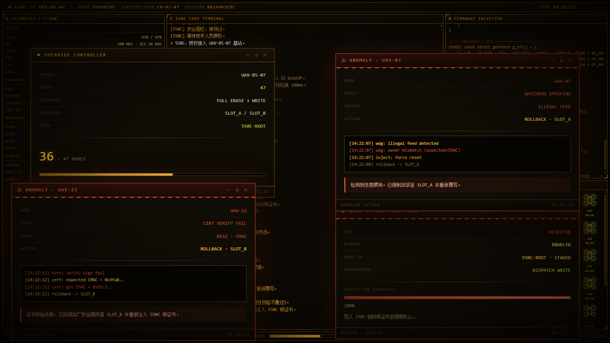

# ChatGPT 550C Boot

在启动 ChatGPT 桌面应用前，先播放一段致敬《流浪地球2》550C 的全屏开机动画，动画播完后再拉起 ChatGPT。

> 通过「启动前覆盖层」实现：不修改、不注入 ChatGPT/Codex 客户端任何文件，删除即完全卸载。
> 联网、登录行为与直接打开 ChatGPT 完全一致。

## 动画预览



## 工作原理

```
用户双击 ChatGPT.lnk / ChatGPT.cmd
        │
        ▼
launcher/ChatGPT-boot.ps1
        │  用 Chrome/Edge --kiosk 全屏打开 550c-overlay.html
        ▼
   播放 550C 开机动画（完整模式约 90 秒，可 Esc/点击跳过）
        │  动画播完（页面标题变为 __550C_DONE__）
        ▼
  关闭覆盖层 → 通过 AppX 定位并启动 ChatGPT（OpenAI.Codex 商店版）
```

- 动画是单个自包含 HTML（`550c-overlay.html`），不依赖网络、外链资源。
- 启动器通过 `Get-AppxPackage -Name "OpenAI.Codex"` 定位商店应用，找不到时回退到 `shell:AppsFolder` AUMID。

## 特性

- 🎬 致敬 550C：Logo 书写 + 47 节点覆写全流程动画
- ⏱ 三种模式：`full`（完整，默认）/ `simple`（仅 Logo）/ `off`（关闭动画）
- ⏭ 可跳过：动画期间按 Esc 或点击立即结束
- 🧹 干净卸载：无注册表、无系统目录写入、删除文件夹即卸载
- 🔒 不碰 ChatGPT 本体：不修改商店应用资源、不写注册表、无需管理员权限

## 使用

```powershell
# 完整模式（默认）
powershell -NoProfile -ExecutionPolicy Bypass -File launcher\ChatGPT-boot.ps1

# 仅 Logo 快速版
powershell -NoProfile -ExecutionPolicy Bypass -File launcher\ChatGPT-boot.ps1 -Mode simple

# 关闭动画直接启动
powershell -NoProfile -ExecutionPolicy Bypass -File launcher\ChatGPT-boot.ps1 -Mode off
```

也可以用 `launcher\ChatGPT.cmd` 双击运行。创建带 ChatGPT 图标的桌面快捷方式的方法见 `docs/使用说明.md`。

### 参数

| 参数 | 说明 |
| --- | --- |
| `-Mode` | `full` / `simple` / `off`，默认 `full` |
| `-DelaySec` | 动画结束后、拉起 ChatGPT 前的缓冲秒数，默认 `1` |

## 依赖

- Windows 10/11
- ChatGPT 桌面应用（商店版 `OpenAI.Codex`，即 ChatGPT for Windows）
- Chrome 或 Edge

## 目录结构

```
chatgpt-550c-boot/
├── 550c-overlay.html   # 动画本体（自包含 HTML）
├── launcher/                  # 启动器（PowerShell + cmd 入口）
├── icons/                     # ChatGPT 官方图标（快捷方式用）
├── docs/使用说明.md            # 中文使用文档
└── examples/                  # 演示素材（可选）
```

## 致谢

- 动画思路与素材参考 [dsh-550c-boot](https://github.com/yannicksong0106/dsh-550c-boot)
- "550C" 设定出自电影《流浪地球2》（The Wandering Earth II）

## 免责声明

本项目为个人学习与美化用途，与 OpenAI 无关。`icons/` 中的图标为 OpenAI 的 ChatGPT 商标素材，仅用于展示与个人使用；如需分发请自行替换为可授权素材。本项目不修改 ChatGPT 客户端本体，不涉及任何破解、越狱或逆向。